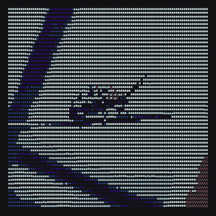
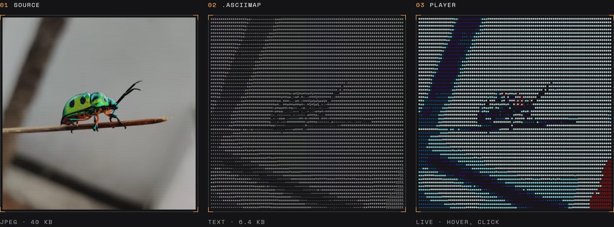
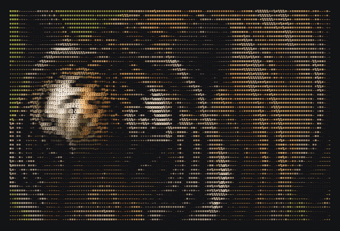
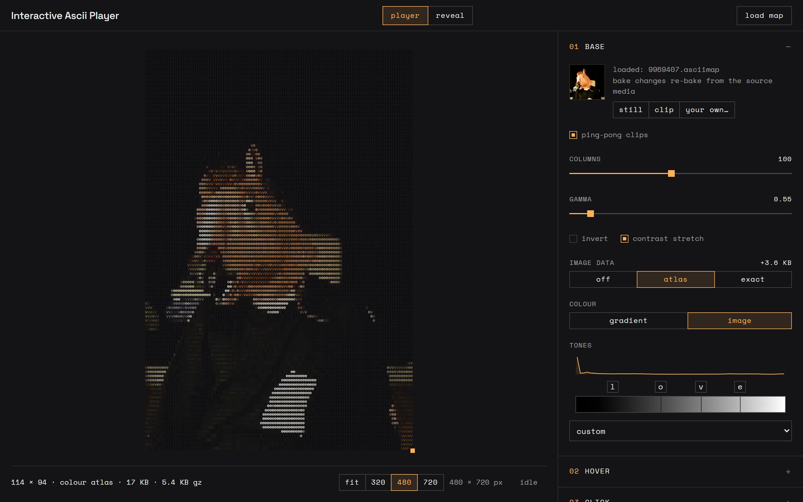
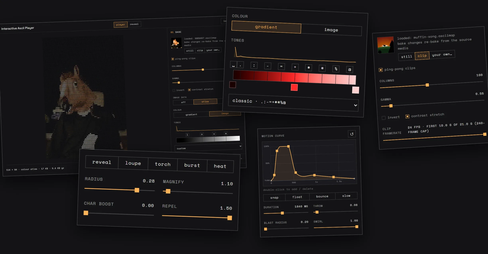

<div align="center">

# ascii anima

**Interactive ASCII media that weigh a few kilobytes.**



[**See it live**](https://asciianima.creativetech.wtf) &nbsp;·&nbsp; [**Make a map**](https://asciianima.creativetech.wtf/mapper.html) &nbsp;·&nbsp; [**In use on creativetech.wtf**](https://www.creativetech.wtf)

</div>

<br>

Image-heavy sites load slowly, and their Lighthouse scores tank. ascii anima takes a photo or a short video and turns it into a grid of text characters, saved as a small `.asciimap` file. This player draws that file live on any website. Move the cursor over it and the characters swell into a lens. Click and they burst outward along a motion curve, then settle back.

<br>

## From a photo to a few kilobytes



The photo on the left is a 40 KB JPEG. The `.asciimap` in the middle is the same picture as plain text, 6.4 KB, and it gzips to 1.2 KB on its way to the browser. The player on the right reads that file and draws it live, crisp at any size.

<br>

## Hover, click, and the photo's own colours



A map can keep the source's colours, stored as one small JPEG at grid size inside the file. Or it can paint its characters with a gradient you pick. Every click throws the characters out and lets them drift home along a curve you draw yourself.

<br>

## A placeholder that becomes the photo

<table>
<tr>
<td width="320"></td>
<td>

The other way to use a map is as a stand-in for a big image. The map shows the moment the page opens, holds while the photo downloads, then resolves into it.

The reader sees the picture straight away, and you only pay for the photo once it arrives.

</td>
</tr>
</table>

<br>

## Make your own in the mapper



The [mapper](https://asciianima.creativetech.wtf/mapper.html) is where maps are made. Load an image or a video, choose how many columns of characters it becomes, and the preview updates as you go. The preview is this player, so what you see is exactly what ships.



Pick your own characters and paint them with a gradient, or keep the photo's colours. Bake video clips of up to 240 frames. Tune the hover lens, and draw the motion curve a click follows. Every setting is saved inside the file.

<br>

## Put it on your site

The player is one file with no dependencies: [`ctwtf-asciiplayer/ascii-player.js`](ctwtf-asciiplayer/ascii-player.js). Copy it next to your page, along with a map you made in the mapper.

```html
<script src="ascii-player.js"></script>
<div id="art"></div>
<script>
  AsciiPlayer.load('art.asciimap').then((map) => {
    AsciiPlayer.mount(document.getElementById('art'), map);
  });
</script>
```

The map carries its own hover and click settings, so it plays exactly as it did in the mapper. Your page decides the colours.

```js
AsciiPlayer.mount(host, map, {
  theme:  { bg: '#131316', ink: '#ECECE9', accent: '#fdb257' },
  config: { radius: 0.2 }   // override anything the map baked
});
```

For the placeholder, give the box the photo's shape and hand over the photo.

```html
<div id="hero" style="aspect-ratio: 2 / 3"></div>
<script>
  AsciiPlayer.load('hero.asciimap').then((map) => {
    AsciiPlayer.reveal(document.getElementById('hero'), map, { src: 'hero.jpg' });
  });
</script>
```

It works as a plain script tag, and with CommonJS or AMD. Touch is handled too: swipes scroll the page, and a long press bursts.

<br>

## Going further

[AGENTS.md](AGENTS.md) has the full reference: every option and method, the `.asciimap` format, and the things to watch for when you build it into a site. It's written so a coding agent can pick it up, and it reads fine for people too.

<br>

<div align="center">

Made by [kesh](https://www.creativetech.wtf) &nbsp;·&nbsp; [MIT licence](LICENSE)

<sub>Gallery photos from <a href="https://www.pexels.com">Pexels</a>: beetle by VEERA vm, tiger by Diego F., astronaut by cottonbro studio, horse mask by armağan.</sub>

</div>
